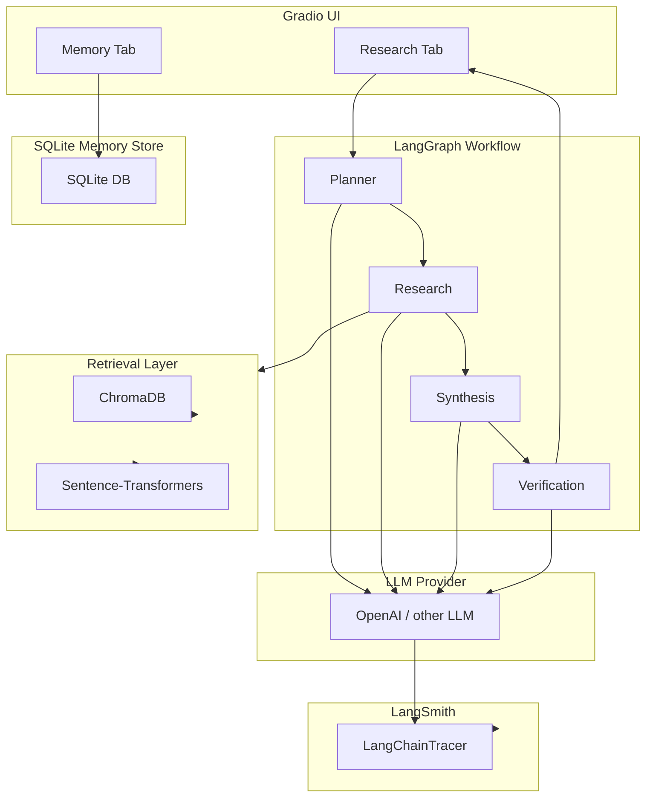

# Asterline AI Research Assistant

## 1. Project Overview
The Asterline AI Research Assistant is a multi‑agent research assistant built in Python. It answers user questions by retrieving relevant company documents, synthesizing answers, and providing citations. The system uses LangGraph to orchestrate agents, ChromaDB for vector search, SQLite for per‑user memory, Gradio for a web UI, and LangSmith for tracing and observability.

## 2. Main Features
- **LangGraph workflow** with Planner, Research, Synthesis, and Verification agents.
- **ChromaDB** local vector store with Sentence‑Transformers embeddings.
- **SQLite** memory store for per‑user notes (CRUD via the UI).
- **Gradio** web interface with a Research tab and a Memory Management tab.
- **LangSmith tracing** for end‑to‑end observability of LLM calls and agent steps.

## 3. Architecture Summary


## 4. Technologies and Their Purposes
- **Python 3.11** – language runtime.
- **LangGraph** – defines the agent workflow and state management.
- **LangChain** – provides LLM wrappers and prompts.
- **ChromaDB** – local vector database for document retrieval.
- **Sentence‑Transformers** – generates embeddings for the corpus.
- **SQLite** – lightweight per‑user memory persistence.
- **Gradio** – simple web UI for chat and memory management.
- **LangSmith** – tracing, logging, and debugging of LLM calls.

## 5. Prerequisites
- Windows 10/11
- Python 3.11 installed and added to `PATH`
- Git (optional, for cloning the repo)

## 6. Windows Virtual‑Environment Setup
```powershell
# From the project root
python -m venv .venv
.\.venv\Scripts\Activate.ps1
```

## 7. Dependency Installation
```powershell
pip install -U -r requirements.txt
```

## 8. Required Environment Variables
Create a copy of `.env.example` named `.env` and fill in the values:
```
LLM_PROVIDER=openai
OPENAI_API_KEY=your-openai-key
LANGSMITH_API_KEY=your-langsmith-key   # optional – enables tracing
LANGCHAIN_TRACING_V2=true               # enable LangSmith tracing
LANGCHAIN_ENDPOINT=https://api.smith.langchain.com
LANGCHAIN_PROJECT=asterline-assistant   # any name you prefer
MODEL_NAME=gpt-4o-mini                 # or another model supported by the provider
```

## 9. Where to Place `corpus.jsonl`
Place the supplied `corpus.jsonl` file in the `data/` directory:
```
asterline-assistant/
├─ data/
│   └─ corpus.jsonl
```
The ingestion script will read it from this location.

## 10. Building the Local Vector Index
Run the ingestion script (provided in `app/retrieval/build_index.py` or similar) to create the ChromaDB collection:
```powershell
python -m app.retrieval.build_index
```
This will generate embeddings and store them in the `chroma/` directory.

## 11. Launching the Application
Start the Gradio UI with a single command:
```powershell
python -m app.ui
```
Open the displayed URL in a browser to interact with the assistant.

## 12. Running the Tests
```powershell
pytest -q
```
All unit and integration tests reside in the `tests/` folder.

## 13. Running the Evaluation Suite
The evaluation scripts are in `app/evaluation/`. Run them with:
```powershell
pytest tests/test_evaluation_suite.py
```
(Replace with the actual test file name if different.)

## 14. Enabling and Inspecting LangSmith Traces
1. Set `LANGSMITH_API_KEY` and `LANGCHAIN_TRACING_V2=true` in `.env`.
2. Run any workflow (e.g., ask a question via the UI or `python -c "from app.agents.workflow import run_workflow; run_workflow('What is the policy?')"`).
3. Open the LangSmith dashboard at https://smith.langchain.com and select the project name you configured (`LANGCHAIN_PROJECT`). You will see spans for each agent step and LLM call.

## 15. Design Document Location
The full architectural design is documented in `docs/design.md`.

## 16. Known Limitations and Provider Requirements
- **Authentication** – Users are identified by synthetic IDs; no real authentication is implemented.
- **SQLite** – Single‑process only; not suitable for high‑concurrency production workloads.
- **Local embeddings** – Works well for a few thousand documents; large corpora may require a dedicated vector store.
- **LangSmith** – Requires a valid API key; without it, tracing is disabled.
- **LLM provider** – The default configuration uses OpenAI; other providers need compatible API keys and may have different rate limits.

---
*Generated on 2026‑10‑28, reflecting the current state of the repository.*
